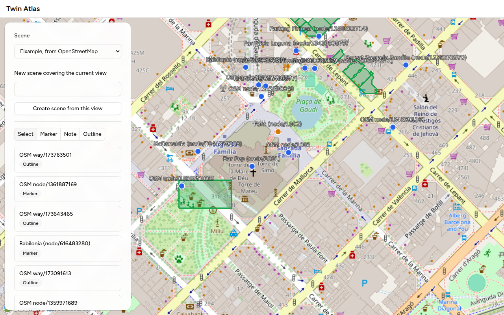
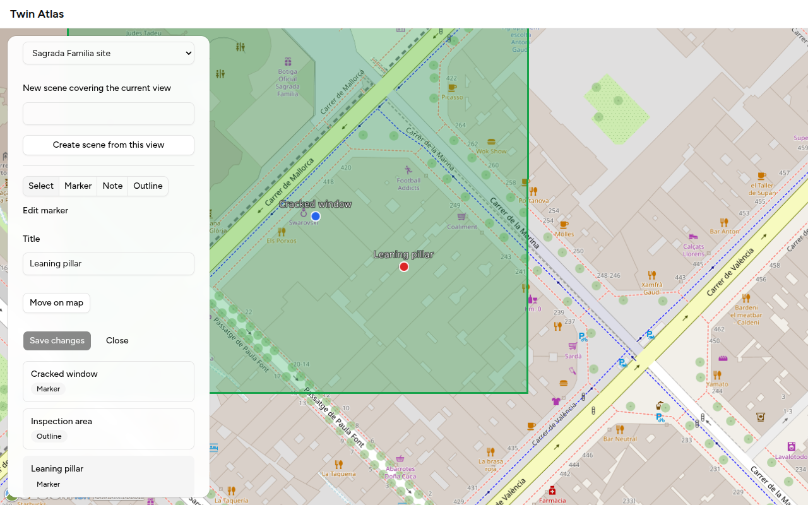
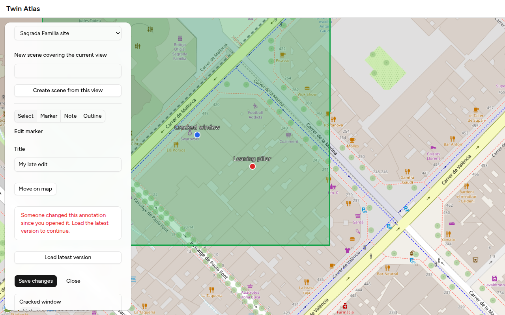

# Twin Atlas

Explore a real place in 3D in the browser, put markers, notes and outlines on it, and find things by area. A Spring Boot and PostGIS API with an Angular and CesiumJS client, built to stay fast on a million annotations.

A digital twin is a photorealistic 3D copy of a real place. Twin Atlas is the platform for exploring and managing the information attached to one, with nothing to install.

## The problem it solves

Information about a real place is scattered. A cracked window is a photo on someone's phone, an inspection area is a line in a spreadsheet, and "the corner on the third floor" is a sentence in an email. None of it is tied to the actual spot, so nobody can ask the obvious questions: what has been noted near here, what is inside this zone, what is in the part of the site I am looking at?

Twin Atlas pins each piece of information to a real position on a 3D map. A **marker** is a point ("this window needs repair"), a **note** is a point with text, an **outline** is an area ("inspection area"). Everyone sees the same place, and things are found by where they are: what is in the current view, what is nearest to a point, what falls inside a zone. It is built to stay fast with a million of them (measured, see below), and other software can read and add to the same data through a documented API.

## Quick start

You need JDK 25, Node 24 and Docker. One command starts the database, the API and the client, waits until they answer, and stops them all when you press Ctrl+C:

```bash
./dev.sh            # then open http://localhost:4200
./dev.sh --check    # only check that your machine can run it
```

Or step by step, in three terminals:

```bash
docker compose up -d                  # PostGIS (repo root)
cd server && ./mvnw spring-boot:run   # API on http://localhost:8080
cd client && npm ci && npm start      # app on http://localhost:4200
```

The running server documents its API with springdoc's Swagger UI (default path `/swagger-ui.html`), and the committed contract is [`docs/openapi.json`](docs/openapi.json). More about the client in [`client/README.md`](client/README.md).

Run the tests (the backend needs Docker for Testcontainers):

```bash
cd server && ./mvnw verify
cd client && npm run lint && npm test -- --watch=false && npm run build
```

## A first session

Five minutes, in the order that makes sense. The [user guide](docs/guide.html) explains every part of the screen, and why the list can be long.

1. **Open the app** at http://localhost:4200. On a fresh database the panel says there are no scenes yet. The map starts at the Sagrada Família in Barcelona.
2. **Make a scene.** A scene is the area you work in. Pan and zoom to a place you care about, type a name under "New scene covering the current view", and press "Create scene from this view". A green rectangle shows the scene's area. Everything you add must fall inside it, and the app tells you when it does not.
3. **Add a marker.** Choose Marker, click inside the green area, give it a title such as "Cracked window", and press Save. A note works the same way and also asks for its text. For an outline, click three or more corners.
4. **Find it again.** The list in the panel shows what is in the current view. Click an item to fly to it, or choose Select and click it on the map.
5. **Edit it.** With an annotation selected you can rename it, change a note's text, or press "Move on map" and click the new position, then "Save changes".
6. **Watch a conflict being refused.** Open the same annotation in two browser tabs. Save a change in one, then save a different change in the other. The second save is refused with "Someone changed this annotation since you opened it", and "Load latest version" shows the change that won. Nothing is overwritten.
7. **Share a place.** The address bar follows your choice (`/scenes/<scene>?annotation=<id>`), so a link opens the same scene and annotation.
8. **Load real data.** There is no import screen yet, but two commands bring in a real OpenStreetMap extract (shops, landmarks, building outlines) through the API:

   ```bash
   curl -s -X POST localhost:8080/api/scenes -H 'Content-Type: application/json' \
     -d '{"name":"Eixample","extent":{"type":"Polygon","coordinates":[[[2.17,41.40],[2.18,41.40],[2.18,41.41],[2.17,41.41],[2.17,41.40]]]}}'
   # copy the "id" from the answer, then:
   curl -s -X POST localhost:8080/api/scenes/<that id>/imports/osm \
     -H 'Content-Type: application/json' --data @server/src/test/resources/osm/overpass-real-eixample.json
   ```

   Reload the page and pick "Eixample" in the scene list: 35 markers and outlines appear. Run the second command again and nothing is added, because the answer reports every element as already imported.

9. **Optional: real 3D buildings.** Create a free token at ion.cesium.com, paste it into the Map section of the panel, and press "Load 3D tiles". It stays in your browser only.

## What works today

- **A 3D map.** A globe in the browser, with Google's photorealistic 3D buildings when you paste a Cesium ion token (otherwise an OpenStreetMap globe). The Cesium code is isolated and loaded on demand.
- **Scenes and annotations.** Create a scene from the current view, click to place a marker, note or outline, and edit or move it later. A save never silently overwrites a newer change: the server refuses a stale edit and the screen offers the latest version.
- **Find things by area.** What is in the current view, the nearest N to a point, everything inside a zone. All keyset-paginated.
- **Bulk import from OpenStreetMap.** `POST /api/scenes/{id}/imports/osm` takes an Overpass answer, imports what is usable and reports every skipped element with a stable code.
- **A typed API.** The server commits its OpenAPI contract, a test fails when it is stale, and the client's SDK is generated from it.

## What it looks like

Screenshots from the running app (headless Chromium, software rendering, the OpenStreetMap globe).



Editing an annotation: the map flies to it, and the editor opens in the panel.



When someone else changed the same annotation first, the save is refused and nothing is overwritten.



## What is worth a look

Each point says where the evidence is.

- **Fast at scale, measured and not claimed.** On 1.2 million annotations on a 4-CPU laptop with 7.8 GiB of memory, a 250 m map view takes 7.5 ms at the median with the spatial index and 254 ms without it, and "10 nearest" takes 5.6 ms against 361 ms. Method, hardware and query plans are in [ADR 0009](docs/adr/0009-benchmark-one-million-rows.md) and [`docs/benchmark/`](docs/benchmark/). The reads are plain SQL, bounding box first and exact test second ([`AnnotationQueries.java`](server/src/main/java/com/twinatlas/annotation/persistence/AnnotationQueries.java), [ADR 0005](docs/adr/0005-reads-bypass-the-core.md)).
- **Correct under concurrency.** Eight clients create the same title at once and exactly one wins. Two people editing the same annotation: the second save is refused (ETag and `If-Match`, status 412). The business rules are advisory under concurrency, so the database has the last word, with a unique index and a version column. The tests are [`AnnotationRaceTest`](server/src/test/java/com/twinatlas/annotation/AnnotationRaceTest.java) and [`UpdateAnnotationRaceTest`](server/src/test/java/com/twinatlas/annotation/UpdateAnnotationRaceTest.java).
- **Rules you can read.** The business rules are pure functions that return `Accepted` or `Rejected(code)`, with table-driven and property-based tests. Start with [`CreateAnnotationRules.java`](server/src/main/java/com/twinatlas/annotation/core/CreateAnnotationRules.java) and [ADR 0003](docs/adr/0003-fcis-decision-functions.md). Architecture tests fail the build if the core touches Spring or one feature reaches into another ([ADR 0013](docs/adr/0013-modular-monolith-with-feature-slices.md)).
- **The API is treated as a product.** The OpenAPI contract is committed and a test fails when it is stale. The client's SDK is generated from it. Every error carries a stable code, visible in the contract and in the client ([ADR 0008](docs/adr/0008-contract-first-sdk.md)).
- **Real data, reported honestly.** The OpenStreetMap import takes what is usable, reports every skipped element with its reason, is safe to repeat and safe when two imports run at once, and is tested on a real extract ([ADR 0011](docs/adr/0011-import-judges-each-element.md)).
- **Modern Angular with guard rails.** Angular 22: zoneless, Signal Forms, `httpResource`, state in the address, Spartan UI. Lint rules fail the build on `any`, on bloated templates, and on imports that cross feature boundaries ([ADR 0014](docs/adr/0014-spartan-ui.md)).
- **A visible process.** Every task has a spec with acceptance criteria and a documentation page that says what was not verified. Tests are checked by breaking the code on purpose, and the mistakes found on the way are written down in the specs. Start at [`docs/index.html`](docs/index.html).

|               |                                                                                                                  |
| ------------- | ---------------------------------------------------------------------------------------------------------------- |
| Backend       | Java 25, Spring Boot 4, Hibernate 7 with Hibernate Spatial, PostgreSQL and PostGIS, Flyway, MapStruct, springdoc |
| Backend tests | JUnit 5, AssertJ, jqwik, Testcontainers, ArchUnit                                                                |
| Client        | Angular 22 (zoneless, Signal Forms, Vitest), CesiumJS, Spartan UI                                                |

## Where to read more

- [`docs/guide.html`](docs/guide.html): the user guide, what each part of the screen does.
- [`docs/index.html`](docs/index.html): the documentation site, one page per task in plain words with diagrams. Open it straight from disk.
- [`ARCHITECTURE.md`](ARCHITECTURE.md) and [`docs/adr/`](docs/adr/README.md): how it fits together and why.
- [`ROADMAP.md`](ROADMAP.md): what is done, what is next, what was left out on purpose.
- [`specs/`](specs/README.md): one file per task with its acceptance criteria and status.
- [`AGENTS.md`](AGENTS.md): the working rules of the project.
- [`THIRD-PARTY-NOTICES.md`](THIRD-PARTY-NOTICES.md): the licences of the code and fonts copied into the project.

Map data in the OpenStreetMap import is © OpenStreetMap contributors, available under the [ODbL](https://www.openstreetmap.org/copyright).
